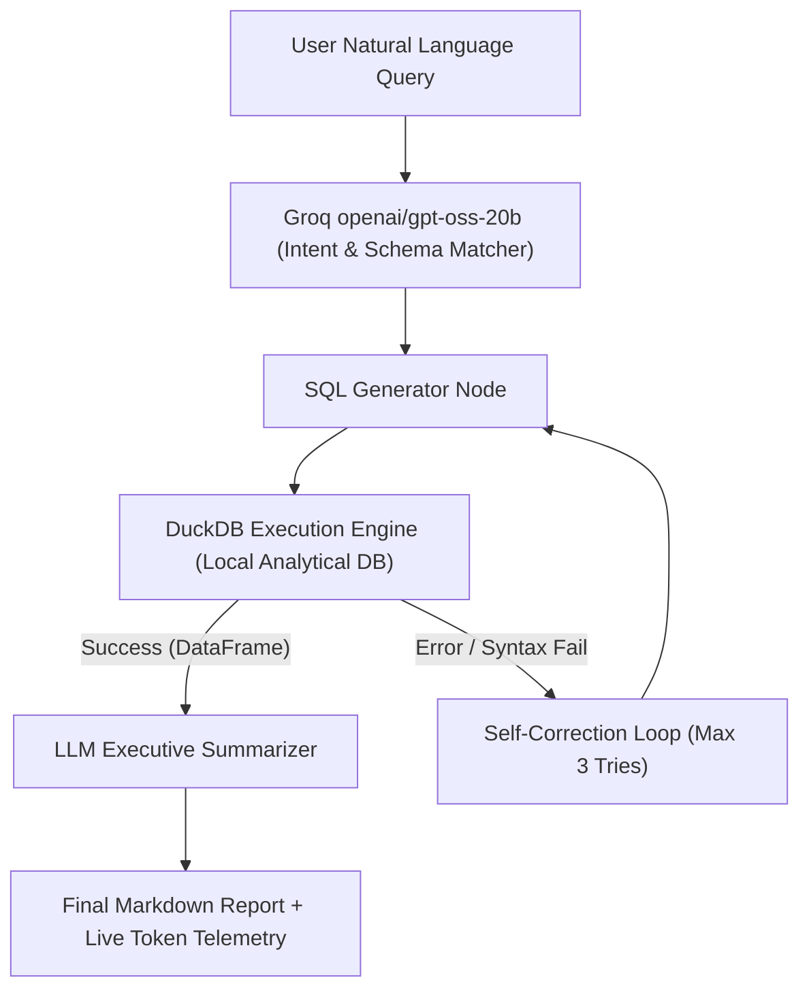

# Autonomous Text-to-SQL & Data Analyst Agent 🚀

A production-grade, self-correcting Agentic Text-to-SQL system that converts natural language questions into executable analytical queries against local DuckDB databases, validates results, and generates executive business summaries with live token telemetry.

---

### 📐 Architecture & Self-Correction Flow



---

### 🛠️ Tech Stack & Zero-Cost Design
- **Agent & LLM API:** GroqCloud (`openai/gpt-oss-20b` at $0.00 cost / high throughput)
- **Analytical Engine:** DuckDB & Polars (Blazing-fast local SQL processing)
- **Validation & Schemas:** Pydantic (Strict JSON extraction & type safety)
- **Cost Control:** Token budgeting, max-retry circuit breakers, and result truncation (max 15 rows)

---

### ⚠️ Architectural Limitations & When NOT to Use Text-to-SQL

While autonomous Text-to-SQL agents provide immense value for ad-hoc business analytics, production engineers must design around inherent LLM constraints:

1. **Handling Out-of-Bounds & Cross-Domain Questions:**
   - **The Risk:** If a user asks a question entirely outside the schema (e.g., *"What is our employee retention rate?"* when only sales data exists), unconstrained LLMs may attempt to hallucinate joins or fabricate columns.
   - **Mitigation:** Our agent relies on strict schema metadata boundaries and DuckDB execution feedback loops. If columns do not exist, the execution engine catches the failure, allowing the agentic loop to recognize the missing context rather than returning fabricated numbers.

2. **Deterministic dbt vs. Agentic LLMs:**
   - **Where to Use dbt / SQLMesh:** Core data pipelines, P&L calculations, official financial reporting, and dimensional modeling must **always** remain deterministic, version-controlled, and tested via dbt. Never use an LLM to generate production ETL logic.
   - **Where to Use the Agent:** Ad-hoc, long-tail data exploration for non-technical stakeholders (e.g., product or sales leads) who need quick answers from clean, pre-modeled staging tables without writing tickets for the data engineering team.

---

### 📊 Example Test Output

```text
==============================
Test Question: What is the total revenue generated in the North region?
==============================
Generated SQL: SELECT SUM(total_revenue) AS total_revenue FROM sales WHERE region = 'North';
Raw Results: [{'total_revenue': 260.0}]
Executive Summary: Total Revenue: $260.00 across all North region transactions.
--- Token Telemetry ---
Estimated Tokens Used: 677 tokens | Cost: $0.00 (Free Tier Active)
```

---

### 🚀 Quickstart & Local Run
1. Clone the repository and navigate inside:
   ```bash
   git clone https://github.com/drazaH21/01-autonomous-text-to-sql-agent.git
   cd 01-autonomous-text-to-sql-agent
   ```
2. Set up virtual environment and install dependencies:
   ```bash
   python -m venv venv
   source venv/Scripts/Activate.ps1  # On Windows PowerShell
   pip install -r requirements.txt
   ```
3. Add your free Groq API key to a `.env` file:
   ```env
   GROQ_API_KEY=your_groq_api_key_here
   ```
4. Run the test suite:
   ```bash
   python tests/test_agent.py
   ```